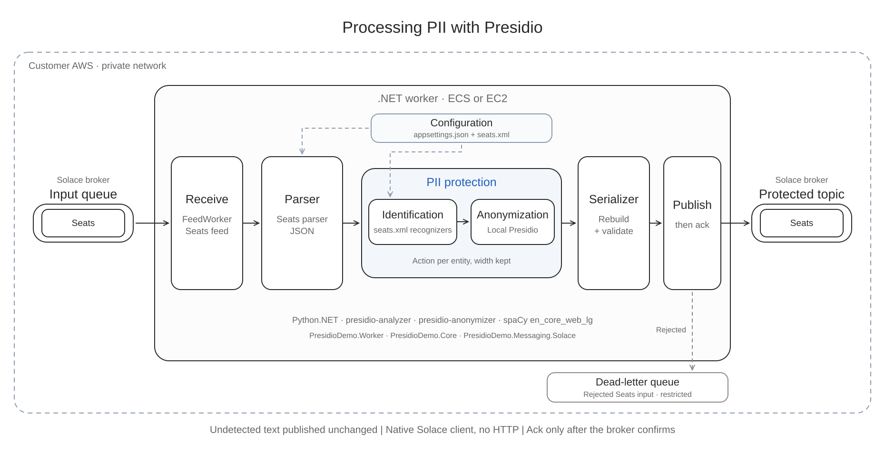

# Presidio Feed Protection Demo

Process the airline Seats feed from a message broker by parsing each JSON message generically and detecting personal data with local Presidio and the feed's recognizer file. Output is validated and confirmed by the broker before the input is acknowledged; rejected input goes to the feed's restricted dead-letter queue.

This repository is the Seats worker: it runs the Seats feed only. It has the same architecture as the PNR worker; only the feed and its JSON parser differ.

## Solution organization

The solution separates feed processing from messaging. Broker-specific code lives only in its adapter project, so another broker (for example Kafka or IBM MQ) is added without touching the feed code.

```text
PresidioDemo.slnx
├── src/
│   ├── PresidioDemo.Core/              feed, decoder, detection, pipeline (no broker code)
│   │   ├── Configuration/recognizers/  seats.xml
│   │   ├── Decoder/                    JsonFeedParser + SeatsParser
│   │   ├── Logging/                    FeedLogger + SeatsFeedLogger, FeedTransactionLog, DetectionLog
│   │   ├── Models/                     FeedContracts, FeedFormats, FeedFileRouting
│   │   ├── Pipeline/                   ProtectedFeedWorkflow + SeatsWorkflow, FeedWorkflowRouter, codec registry, FeedMessageProcessor
│   │   └── Protection/                 recognizer file, anonymizer, detecting protector, python/presidio_demo.py
│   ├── PresidioDemo.Messaging/         broker-neutral ports and models (no broker package)
│   │   ├── Abstractions/               IMessagingConnection, IMessageConsumer, IMessagePublisher
│   │   └── Models/                     InboundMessage, OutboundMessage, MessagingOptions, MessageRoute
│   ├── PresidioDemo.Messaging.Solace/  the only project that references the Solace .NET client
│   │   ├── Connection/                 SolaceOptions, SolaceConnection (session, TLS, reconnect, confirmations)
│   │   ├── Listener/                   SolaceMessageConsumer (queue flow, client acknowledgment)
│   │   ├── Publisher/                  SolaceMessagePublisher (persistent publish, waits for confirmation)
│   │   ├── Models/                     SolaceMessageMapper (native message <-> broker-neutral records)
│   │   └── SolaceMessaging.cs          AddSolaceMessaging registration
│   └── PresidioDemo.Worker/            the deployable: Generic Host, appsettings.json, one FeedWorker for the Seats route
│       ├── Hosting/                    EnvironmentConfiguration, MessagingTransports, PresidioOptions
│       └── Pipeline/                   FeedWorker, FeedWorkerService
├── tests/
│   ├── PresidioDemo.Messaging.Testing/ in-memory broker (tests only, never shipped)
│   ├── Messaging.ContractTests/        the behaviour every broker adapter must pass
│   ├── WorkerChecks/                   environments, settings validation, delivery rules (no Python)
│   ├── FeedPipelineHarness/            runs files through the real worker and Presidio
│   ├── FeedPipelineChecks/ FeedRoundTripChecks/ GenericCodecChecks/   feed and codec checks
│   ├── DetectionParityChecks/          parity gate, recognizer checks, detection-log run, throughput
│   ├── fixtures/                       value-free parity baseline, approved exceptions, spike summary
│   └── unit-tests/                     Python tests, driven through the harness
├── tools/FeedOutputReader/             subscribes to the output topics and logs each message's decoded values
├── tools/FeedSampleSender/             sends sample files to a running worker's input queue
├── Dockerfile                          the worker image (Linux, embedded CPython, Presidio, spaCy model)
└── deploy/
    ├── docker-compose.yml              local Solace broker; with --profile worker, the worker container too
    ├── docker-compose.dev.yml          the worker container against the Dev broker
    └── .env.dev.example                Dev values to copy into the git-ignored deploy/.env.dev
```

Project references point inward only: Worker → Core, Messaging and the adapters; adapters → Messaging. Core never references messaging, and Messaging never references a broker. Concern folders are flat: each holds a base class and the Seats feed's sealed child where the feed needs one, and every namespace is the project plus its folder (for example `PresidioDemo.Core.Decoder`, `PresidioDemo.Messaging.Solace.Connection`, `PresidioDemo.Worker.Hosting`); `test_project_layout.py` checks both. The Python environment stays at `src/.venv`; the container image uses `/opt/venv` through `Presidio:PythonEnvironment`.



## Messaging design

The worker runs one `FeedWorker` for the Seats route. Each message goes through the same steps on every broker:

1. **Receive** from the feed's input queue (`IMessageConsumer`). The broker sends the next message only after this one is acknowledged, so each consumer has one active message.
2. **Process** with `FeedMessageProcessor` (Core): parse the JSON, detect and protect with local Presidio, rebuild and validate.
3. **Publish** (`IMessagePublisher`) and wait for the broker's confirmation:
   - valid: the feed's output topic, with a stable transaction ID, the input correlation ID and only the headers listed in `Messaging:CopyHeaders`;
   - invalid: the feed's restricted dead-letter queue, with the original bytes and the reason in the `presidio-reject-reason` header.
4. **Acknowledge** the input (`InboundMessage.CompleteAsync`).

A crash at any step means the broker redelivers the message, so nothing is lost. The transaction ID is derived from the broker's stable message ID, so a redelivered message produces output with the same ID and consumers can drop duplicates (at-least-once delivery). While the broker is unavailable, publishing is retried and the input stays unacknowledged. A message delivered more than `Messaging:MaxDeliveries` times goes to the dead-letter queue without processing. Producers send the feed bytes as the message body; the header `presidio-payload-format` is `raw` (default) or `mq-export` for an IBM MQ export with `A`/`X` lines.

Rejected input and the full before/after comparison contain personal data. In production, rejected input goes only to the dead-letter queue (restrict it with broker access rules), and logs contain only the feed, transaction ID, outcome, field counts and timings. Full before/after logs are written only by the test harness.

### Adding another broker (for example Kafka)

Kafka is not implemented. To add it, or any other broker:

1. Create `src/PresidioDemo.Messaging.Kafka/` with the same folders as the Solace adapter (`Connection/`, `Listener/`, `Publisher/`, `Models/`). Reference only `PresidioDemo.Messaging` and the broker's native client (for Kafka, `Confluent.Kafka`; don't use Schema Registry, which is HTTP).
2. Implement the three ports:

   | Port | Solace (implemented) | Kafka (to implement) |
   | --- | --- | --- |
   | `IMessagingConnection.ConnectAsync` | session over tcp:// or tcps:// | consumer and idempotent producer over SASL/TLS |
   | `IMessageConsumer.ReadAsync` | queue flow, window 1, client acknowledgment | consumer group, `EnableAutoCommit=false`, one message at a time per partition |
   | `InboundMessage.StableId` | replication-group message ID | `topic-partition-offset` |
   | `InboundMessage.DeliveryCount` | broker delivery count | a retry-count header, or 1 |
   | `InboundMessage.CompleteAsync` | `flow.Ack(id)` | `Commit(offset)` in partition order |
   | `IMessagePublisher.PublishAsync` | persistent message, waits for the broker acknowledgment | `ProduceAsync` with `Acks=All` and `EnableIdempotence=true` |
   | Dead-letter destination | Solace queue | dead-letter topic |

3. Add `AddKafkaMessaging(...)` and one case in [MessagingTransports.cs](src/PresidioDemo.Worker/Hosting/MessagingTransports.cs), plus a `Kafka` section in the environments that use it, and set `Messaging:Transport` to `Kafka`.
4. Add the adapter to the list in [tests/Messaging.ContractTests/Program.cs](tests/Messaging.ContractTests/Program.cs). It must pass the same contract as the in-memory broker and Solace.

Nothing in Core, the feed code, the worker or the route changes.

## Configuration and environments

All settings are in one file, [src/PresidioDemo.Worker/appsettings.json](src/PresidioDemo.Worker/appsettings.json):

- **Shared settings** at the top: `Messaging` (transport and delivery limits), `Presidio` (`RecognizerDirectory`, `DetectionLog` and an optional `PythonEnvironment` folder) and `Logging`.
- **`Environments`**: one section per environment, holding only what differs, including its `Messaging:Routes` (`Feed`, `Input`, `Output` and `DeadLetter`). Today these are `Local` (local broker), which routes the Seats feed as route 0, and `Dev`, which has no route: no Dev queue or topic names have been supplied for Seats, so a Dev deployment must supply route 0 through environment variables (`Messaging__Routes__0__Feed=Seats` and its `Input`, `Output` and `DeadLetter`) or it stops at startup. Adding `QA`, `UAT` or `Prod` means adding one more block.
- **`CurrentEnvironment`**: the default when nothing else selects one (`Local`, for developer machines).

The `DOTNET_ENVIRONMENT` variable selects the environment; if it isn't set, `CurrentEnvironment` in the file applies. On AWS, each environment's ECS task definition (or EKS pod spec) sets `DOTNET_ENVIRONMENT` (for example `QA`), so the same image runs everywhere. Values are applied in this order, with later ones winning: shared settings, then the selected environment's section, then environment variables with double underscores (for example `Solace__Host` or `Messaging__Routes__0__Input`). The `Dev` section holds DemoAir stand-in names only; the real broker, VPN, user and queue names are supplied through environment variables at deploy time and are never committed.

Secrets are never in the file. `Solace:PasswordEnvironmentVariable` names the variable holding the password (`SOLACE_PASSWORD`). On AWS, the task definition's `secrets` field injects it from Secrets Manager when the task starts, so the application makes no AWS calls.

Startup stops with one clear message for any of these:
- an environment without a section
- unknown sections or keys
- a password in the file
- an HTTP host, or `tcps://` without certificate validation
- no route at all (as in `Dev` until its Seats route is supplied), a route for a feed this build does not support, a feed with more than one route, or shared or wildcard destinations. Settings written for a build with more feeds stop startup with, for example, `Messaging:Routes:0 names feed 'PNR', which this build does not support.`
- a `Presidio:PythonEnvironment` folder without `pyvenv.cfg`
- an invalid or missing recognizer file (`Presidio:RecognizerDirectory`)

`Solace:ProvisionQueues` creates the input and dead-letter queues and is enabled only for `Local`; other environments use queues provisioned by the broker team.

**One feed per service.** `Messaging:Feed` (for example `Messaging__Feed=Seats` in a task definition) makes the process consume only that feed's route, so the feed runs as its own ECS service and scales on its own. When it is empty, the process runs every routed feed. A value without a route stops startup.

**Parallel consumers.** `Messaging:ConsumersPerTask` (1 by default, at most 32) opens that many consumers on the routed input queue. All of them share the task's one broker connection. Each consumer reads one message at a time, so broker round trips overlap while Python calls stay serialized. On a partitioned queue, the broker assigns partitions to each consumer, which keeps the order for each partition key. On an exclusive queue, such as the queue the Local broker provisions, the extra consumers wait as hot standby and add no throughput. Set it per task definition, for example `Messaging__ConsumersPerTask=8`, once the feed's queue is partitioned.

**Unique client names.** The broker disconnects an existing connection that reuses a client name. `Solace:UniqueClientName` (on in `Dev`) appends the host name and a random part to `Solace:ClientName`, such as `piidemo-worker-dev-ip-10-0-1-23-ec2-internal-3f9a1c2e`. This lets several tasks of one service connect at the same time, and the name stays within the broker's 160-character limit.

## Architecture diagrams

- [PII infrastructure on AWS](docs/diagrams/aws-pii-infrastructure.svg): proposed dev environment with a Solace broker, an exclusive input queue for the Seats feed and acknowledgment after publish.
- [AWS deployment, one ECS service for the Seats feed](docs/diagrams/aws-solace-ecs-deployment.svg): a generic view of the Harness build and deploy, the Solace broker in AWS, the input queue and DLQ, the Seats worker with parallel consumers and auto scaling, the protected topic with output queues for downstream consumers, and the failed-message and broker backstop paths. Specific values are in [docs/aws-deployment-plan.md](docs/aws-deployment-plan.md).
- [Dead-letter queues](docs/diagrams/pii-feeds-dead-letter-queues.svg): the Seats input queue, its restricted dead-letter queue and who may read it.
- [Seats worker retry flow](docs/diagrams/seats-worker-retry-flow.svg): redelivery, publish retries and dead-lettering for the Seats worker.
- [Feed protection workflow](docs/diagrams/presidio-feed-workflow.svg): the Solace input queue, the .NET worker (receive, parse the JSON, local Presidio, rebuild and validate, publish then acknowledge), the protected topic and the restricted dead-letter queue.

## C# conventions

Types and members include XML summaries. Parameters, return values and property values are documented where applicable, including positional record values and non-public helpers. The application build generates XML documentation.

Declarations use regions for fields and constants, constructors, methods, properties and indexers, and nested types. A file with only one top-level class does not need an outer `Classes` region; member regions inside that class still apply. Methods and properties are ordered by accessibility and then name; overloads stay together. Fields without runtime initializers are sorted by name, while initialized fields retain their construction order. Enum declarations retain their existing numeric and wire order (`FeedType.Seats` keeps the value 3). Control-flow and scoped resource statements use explicit blocks. Documentation does not add runtime annotation attributes.

The root [.editorconfig](.editorconfig) shares C# formatting preferences with Visual Studio. See [C# formatting and cleanup](docs/code-cleanup.md) for the cleanup profile, terminal commands and rules that still require review.

## Decoded-text detection

The Seats feed is JSON (an object root) and is parsed generically; there is no schema or field list, so a template change does not stop protection.

`SeatsParser` (a `JsonFeedParser`) reads the IBM MQ export or raw payload with System.Text.Json. Every JSON string value is a detection candidate, located by its key path (a JSON Pointer such as `/OrderChangeNotif/Old/Customers/0/FirstName`). Numbers, booleans and nulls are never candidates and never change. An MQ export must declare UTF-8 (CCSID 1208); no code-page conversion is guessed, so `SEATS_02_Negative_Testing.txt` (CCSID 437) is dead-lettered by design. Duplicate or `*` property names, trailing data and truncated JSON are dead-lettered too. Protected values are written back at the same width, and validation rejects any change outside the protected strings: property names, separators, whitespace, numbers, the MQ metadata and the hex rows stay byte for byte as received.

The feed's recognizer file is [src/PresidioDemo.Core/Configuration/recognizers/seats.xml](src/PresidioDemo.Core/Configuration/recognizers/seats.xml). It is a Presidio-style XML: a flat list under `<recognizers>` that mirrors Presidio's recognizer registry YAML, its `analyze` allow list and its anonymizers map, using Presidio's names (WR-014). Presidio's format has no notion of a JSON key, so this worker adds one element, `<key>`, for JSON feeds (see below). Each decoded string is decided on its own:

1. **Recognizer key.** A string at or below a property that a custom recognizer lists as a `<key>` is that recognizer's entity, in full (score 1), decided in .NET without Presidio. The deepest such property on the path decides, so the values of the `Attributes` array, or a value nested under `FirstName`, are protected by that key. Keys match property names ignoring case. A number or boolean under such a key cannot be protected in its JSON type, so the message is dead-lettered (WR-016). A recognizer key wins over the allow list, so an allow-list item never releases a value the file declares as personal data.
2. **Allow list.** A string whose own property is an `<allow_list>` `<key>` (the operational properties such as `SeatNumber`, and the PNR in `UARecloc`), or that matches an `<allow_list>` item end to end (exact text, or a regex with `match="regex"`), is published unchanged without analysis. An item never releases a piece of a longer string: `2026-11-09` is kept by the timestamp item, but a date inside a longer remark is still analyzed. Regex items match case-insensitively, as patterns do; exact items compare case-sensitively. Each item must be a valid regex on its own: one that only compiles inside the whole-string wrapper (an unbalanced `)`) stops startup.
2. **Detection.** Every Presidio predefined recognizer runs (spaCy NER for `PERSON`, `LOCATION`, `NRP` and `DATE_TIME`; patterns for `EMAIL_ADDRESS`, `CREDIT_CARD`, `IP_ADDRESS` and the rest), unless the file switches it off by class name with `<recognizer name="…" type="predefined" enabled="false" />`. The file's `type="custom"` recognizers add Seats-specific patterns, context words and deny lists; a recognizer with keys only (such as `passengerId`) is not sent to Presidio. Spans scoring below `default_score_threshold` are ignored.
3. **Actions.** Each detected span gets its entity's `<anonymizer>`, else the `DEFAULT` one, else Presidio's default `replace` (`<ENTITY>`). The operators are Presidio's `mask`, `replace`, `redact`, `hash` and `keep`, with Presidio's parameter names (`masking_char`, `chars_to_mask`, `from_end`, `new_value`, `hash_type`, `salt`); `encrypt`, `custom` and `surrogate_ahds` stop startup. Overlapping spans of different entities are resolved by score, then length, then position.
4. **Width.** Every result is fitted to the width of the text it replaces: padded with spaces or cut (WR-015). `Alex Sample` becomes `***********` with `mask`, `<PERSON>` and three spaces with `replace`, eleven spaces with `redact`, and the first eleven hex characters of its hash with `hash`; in a five-character value, `replace` writes `<PERS`.
5. **Nothing detected.** A string in which nothing is detected is published unchanged and listed for review in the detection log. There is no PNR anchor: the PNR (`UARecloc`) is published unchanged because its key is allowed, and a missing or malformed PNR does not dead-letter the message.

Local Presidio runs once per message as a batch through Python.NET, and returns spans only; every decision is made in .NET. A message is dead-lettered only for a structural failure: undecodable framing, malformed JSON or an MQ export that is not UTF-8, a number or boolean under a recognizer key, a recognizer pattern that times out (the bridge sets Presidio's limit to one second and treats a skipped pattern as a failure), or a rebuild that differs outside the protected strings (WR-016). An invalid recognizer file stops startup with a message naming the file and the problem, such as a retired element (`<builtIn>`, `<keep>`, `<format>`, `<pnrAnchor>`, `defaultMaskCharacter`), an unknown attribute, a rejected operator, a regex that does not compile, or a `<key>` that is empty, `*` or declared twice (once per file, across recognizers and the allow list).

Custom recognizers, keys and actions, with fictional data. `{"FirstName":"Jordan","SeatNumber":"23C","Remarks":"REF 1234 MILLER/JORDAN"}` publishes as `{"FirstName":"******","SeatNumber":"23C","Remarks":"REF 1234 *************"}`:

```xml
<recognizer name="passengerName" type="custom" supported_entity="PERSON">
  <pattern name="surname/given" score="0.9">(?&lt;![A-Z])[A-Z]{2,}(?:[ '-][A-Z]+)*/[A-Z]+(?:[ '-][A-Z]+)*</pattern>
  <key>FirstName</key>
  <key>LastName</key>
</recognizer>
<allow_list match="regex">
  <item>\d{4}-\d{2}-\d{2}(?:T\d{2}:\d{2}:\d{2}(?:\.\d{1,7})?Z?)?(?: [A-Z]{2})?</item>
  <key>SeatNumber</key>
</allow_list>
<anonymizer entity="PERSON" type="mask" masking_char="*" />
<anonymizer entity="DEFAULT" type="mask" masking_char="#" />
```

Patterns use syntax shared by .NET and the Python `regex` module and match case-insensitively. `<context>` and `<deny_list>` take space-separated words; a context word near a match raises its score. `<key>` takes one property name, trimmed; it may be declared once per file. The named entities mask with `*`; `DEFAULT` masks with `#`, so a value masked without an action of its own stands out.

### Changing a recognizer or an action

1. Edit `Configuration/recognizers/seats.xml`: add or change a `<recognizer>` or its `<key>`s, an `<allow_list>` item or key, or an `<anonymizer>`. Each custom recognizer has a one-line `Example:` comment with fictional values (such as `MILLER/JORDAN` or `K7QX2M00001`); add one for a new entry, never with real data.
2. Check parity: `src/.venv/Scripts/python.exe tests/run_sample_verification.py`. Every value in [tests/fixtures/parity-baseline.json](tests/fixtures/parity-baseline.json) must stay protected or be listed with a reason in [parity-exceptions.json](tests/fixtures/parity-exceptions.json) (WR-019); a released value fails this developer check, never the worker. Masking something the baseline does not list never fails it. Both files are value-free: sample, JSON Pointer, length, and an entity or a reason. The baseline was frozen from the field policies an earlier design used and cannot be regenerated. Every baseline entity type must have a custom recognizer or a Presidio predefined entity, and every baseline location must sit under a recognizer key of its entity (`DetectionParityChecks -- config-checks`).
3. Open a pull request. The recognizer file ships only inside the image built from it (PR-005), so a change reaches an environment by deploying that image. While decoded-text detection is a POC, that image is deployed to Dev only ([deployment plan](docs/aws-deployment-plan.md)).

### Detection log

`Presidio:DetectionLog` (on in the `Local` environment, off in the base settings and so in `Dev`; for example `Presidio__DetectionLog=true` in the task definition, read at startup) writes one block per message to the worker's standard output (WR-018). The header names the feed, the transaction, the outcome, the source file (`file=`, the message's correlation ID, which the sample sender and the harness set to the file name; `-` when there is none), the number of fields identified (`fields=`), and how many are PII, non-PII and for review. Below it, every decoded string is listed exactly once, in one of three groups:

- **PII fields (changed):** an action changed the string (`decision=changed`).
- **Non-PII fields (unchanged):** an allow-list item kept it (`allowed`), the `keep` operator left it (`kept`), or it is empty.
- **Review (check these; each line has a fix):** the string was left unprotected (`nothing-detected`, or `below-threshold` with its score against the threshold), changed by an entity with no anonymizer of its own (`no-action`), changed by a spaCy guess (`spacy-guess`), or affected by an overlap or a cut result (`overlap`, `cut`). Each review line names its reasons and a fix, such as `fix="add a recognizer if this is personal data, or an allow-list item if it is not"`.

Without the values flag a block holds no value, only lengths and character shapes, so it may be switched on in any environment. A string is located by its JSON Pointer; a property name the recognizer file does not declare as a `<key>` could itself be a value in dynamic-key JSON, so it is shown as `?`, while array indexes stay. A made-up example:

```text
Seats 3f9a… DETECTION PUBLISHED file=SEATS_DEMO.txt fields=4 pii=1 non-pii=1 review=2
  PII fields (changed)
    /?/?/?/0/BookedAsName  len=13 shape=AAAAAA/AAAAAA  recognizer=passengerName entity=PERSON score=1.00 operator=mask decision=changed
  Non-PII fields (unchanged)
    /?/?/?/0/SeatNumber    len=3 shape=99A  recognizer=allow_list entity=- score=0.00 decision=allowed
  Review (check these; each line has a fix)
    /?/?                   len=6 shape=AAA999  unchanged  recognizer=none entity=- score=0.00 decision=nothing-detected reason=nothing-detected fix="add a recognizer if this is personal data, or an allow-list item if it is not"
    /?/?/1                 len=8 shape=A9999999  unchanged  recognizer=UsLicenseRecognizer entity=US_DRIVER_LICENSE score=0.30<0.50 decision=below-threshold reason=below-threshold fix="add context words or raise the pattern score if this is personal data"
```

An empty group is printed as `(none)`. A message dead-lettered after detection ran has `DEAD-LETTERED` and its reason in the header; a message rejected before detection (for example, malformed framing) has no block. Every line after the header is indented, so a log collector can keep the block as one entry (see the CloudWatch setting in the [deployment plan](docs/aws-deployment-plan.md)).

**Acting on a review entry.** Follow its fix: for personal data that nothing detected, add a custom recognizer for the value's shape; for a value that is not personal data but a spaCy guess changed, add an allow-list item; for an entity without its own action, add an `<anonymizer>`. Then follow [Changing a recognizer or an action](#changing-a-recognizer-or-an-action).

**Values in non-production (WR-020).** For testing in Local, Dev and QA, `Presidio:DetectionLogValues` (on by default, read at startup; `Presidio__DetectionLogValues=false` turns it off) adds the actual values and the full pointer: `"before" -> "after"` for a changed string, `"before"` for an unchanged one, and `-> not published` for a dead-lettered message. Values and pointers are JSON-encoded, so none of them can break a line:

```text
Seats 3f9a… DETECTION PUBLISHED file=SEATS_DEMO.txt fields=4 pii=1 non-pii=1 review=2
  PII fields (changed)
    "/OrderChangeNotif/Old/Customers/0/BookedAsName"  "MILLER/JORDAN" -> "*************"  recognizer=passengerName entity=PERSON score=1.00 operator=mask decision=changed
  ...
```

- It needs `Presidio:DetectionLog` on as well. With only the values flag set (as in `Dev` by default), the worker writes no detection blocks and logs one warning at startup.
- It works only when the selected environment is `Local`, `Dev` or `QA` (an unset `DOTNET_ENVIRONMENT` falls back to `Local` and counts). In any other environment, such as `Prod`, the worker still starts: it switches the values flag off, prints one `WARNING` line, and writes value-free blocks only.
- Blocks are written for published messages and for messages dead-lettered after detection ran.
- Outside Local, while both `Presidio:DetectionLog` and `Presidio:DetectionLogValues` are on, the deployment's log group must keep entries for at most 7 days and be readable only by the PII team role. Either flag is switched only through a reviewed task-definition deploy. Because the values flag is on by default, switching the detection log on in `Dev` or `QA` is what starts writing values (PR-006, [deployment plan](docs/aws-deployment-plan.md)).
- The test harness runs the same modes with `--detection-log on` and `--detection-log values`.

**Harness files.** Each before/after file in `logs/Seats/` holds the block with values right after the decoded payload, so a pointer can be followed there. Each run also writes `detection-summary.txt` beside `report.json` (WR-021): every review-group field across the run, by its path with array indexes as `*` (JSON-encoded when a property name is not printable ASCII), with its review reasons, character shapes, a count and the file names. It holds no string value.

### Results on the supplied samples

The three Seats samples run through the real worker and local Presidio: `SEATS.txt` and `SEATS_03.txt` are published, and `SEATS_02_Negative_Testing.txt` (the same message exported with CCSID 437) is dead-lettered before detection, as in the multi-feed build. All 48 values the former field policies protected in the two published samples (names, passenger and order IDs, the employee ID and the seat attribute codes) are protected, so [parity-exceptions.json](tests/fixtures/parity-exceptions.json) is empty, and both PNRs are published unchanged. Every string of the samples sits under a recognizer key or an allowed key, so nothing in them is listed for review and no sample string reaches Presidio: `SEATS.txt` has 29 changed and 29 allowed strings, `SEATS_03.txt` 19 and 31. A string under a property the file does not declare goes to Presidio and is listed for review when nothing is detected. The value-free spike summary is in [tests/fixtures/spike-summary.json](tests/fixtures/spike-summary.json).

### Known limits

- A string in which nothing is detected is published unchanged (fail open, WR-014). Presidio's documentation notes that automated detection is not guaranteed to find all sensitive information; the detection log lists every such string under Review, and `detection-summary.txt` collects them, so a recognizer can be added.
- spaCy NER guesses: under an undeclared property it can detect an operational value (a PNR such as `JQWX4H` as `LOCATION`, a three-letter code as `PERSON`, a timestamp as `DATE_TIME`) and change it. Such lines are listed under Review as `spacy-guess`; an allow-list key or item keeps a value that must stay unchanged. This is why the operational Seats properties are allowed keys.
- An allowed key releases every string directly under it, whatever it holds, and a recognizer key protects every string below it, so both rely on the producer using the property as documented. A personal-data value under a new, undeclared property is analyzed by Presidio only.
- An allow-list item releases every whole string it matches, whatever it holds. The shipped timestamp item also keeps a standalone date of birth such as `1985-03-12` in its own string under an undeclared property; inside a longer string it is still analyzed.
- A result longer than the text it replaces is cut (`<PERS` for a five-character name with `replace`) and listed for review; `mask` never is.
- `hash` writes the first characters of a 64- or 128-character hex digest, as many as the value is wide, and is not listed as cut. Without `salt`, each value gets a random salt, so equal values do not hash alike; with a fixed `salt`, a short value cut to a few hex characters can be guessed by trying values, so prefer `mask` for short values.
- A protected string keeps its width in characters. A non-ASCII value (such as `José`) masked with `*` is shorter in UTF-8 bytes, so the payload and the MQ hex rows can change length; the bytes outside the protected strings still stay exact. The supplied samples are ASCII.
- A Presidio regex timeout is detected through Presidio's "timed out" warning. Recheck `test_presidio_rules` when Presidio is upgraded.

## Technology stack

| Technology | Version |
| --- | --- |
| C# / .NET | .NET 10 |
| Python.NET | 3.2.0 |
| CPython | 3.12.10 |
| Presidio Analyzer / Anonymizer | 2.2.364 |
| spaCy / en_core_web_lg | 3.8.16 / 3.8.0 |

Python runs inside the .NET worker process. Processing makes no HTTP calls or model downloads; the broker connection uses the native Solace protocol.

## Setup and run

Running from source requires Windows, the .NET 10 SDK and Python 3.12; running against a local broker also needs Docker or Podman. Run these steps in PowerShell from the project root. The [container image](#run-the-worker-in-docker) needs only Docker.

### 1. Create the Python virtual environment

Do this once during initial setup:

```powershell
py -3.12 -m venv src/.venv
```

### 2. Activate the Python virtual environment

Activate it whenever you open a new PowerShell terminal:

```powershell
.\src\.venv\Scripts\Activate.ps1
```

If PowerShell reports that running scripts is disabled, allow locally created scripts for this terminal session, then retry activation:

```powershell
Set-ExecutionPolicy -Scope Process -ExecutionPolicy RemoteSigned
.\src\.venv\Scripts\Activate.ps1
```

If prompted, enter `Y`. The policy change lasts only until this PowerShell terminal closes; administrator access is not required. See [PowerShell execution policies](https://learn.microsoft.com/en-us/powershell/module/microsoft.powershell.core/about/about_execution_policies).

If your organization enforces a policy that still blocks activation, use the Python launcher to install packages for its selected interpreter:

```powershell
py -m pip install -r requirements.txt
```

With an active virtual environment and no explicit Python version, `py` uses that environment. Without activation, `py` uses its default interpreter and may install packages outside `src/.venv`. If activation remains blocked, confirm the selected interpreter with `py -c "import sys; print(sys.executable)"` before installing; it should end in `src\.venv\Scripts\python.exe` for this project.

The prompt normally shows `(.venv)` after activation. Confirm Python uses this environment:

```powershell
python -c "import sys; print(sys.executable)"
```

The path should end in `src\.venv\Scripts\python.exe`.

### 3. Install the Python packages

With the virtual environment active, install the required packages:

```powershell
python -m pip install -r requirements.txt
```

### 4. Deactivate the Python virtual environment

After package installation finishes, deactivate it:

```powershell
deactivate
```

### Build

```powershell
dotnet build PresidioDemo.slnx
```

### Run locally against a Solace broker

The `Local` environment expects a Solace broker on `tcp://localhost:55555` and creates its queues on startup. Start one with Docker Desktop (WSL2 backend), then run the worker. The broker admin password comes from `$env:SOLACE_ADMIN_PASSWORD` or from a git-ignored `deploy/.env` file containing `SOLACE_ADMIN_PASSWORD=<choose one>`:

```powershell
docker compose -f deploy/docker-compose.yml up -d   # first start takes about 30 seconds
$env:SOLACE_PASSWORD = "<client password; any value on the default local broker>"
dotnet run --project src/PresidioDemo.Worker
```

Wait for `READY`, then send the samples from another terminal. The sender connects as `<ClientName>-sender`, because the broker allows one connection per client name and would otherwise disconnect the running worker:

```powershell
$env:SOLACE_PASSWORD = "<same value>"
dotnet run --project tools/FeedSampleSender
```

Protected messages are published to the `airline/seats/protected` topic and rejected ones go to the `q.seats.dlq` queue. A topic keeps nothing without a subscriber, so start the output reader before sending. It subscribes to each route's output topic as `<ClientName>-reader`, decodes every message with its feed's codec, and writes the published (protected) value of each decoded value, by JSON Pointer, to a text file under the git-ignored `.test-runs/output-reader/`:

```powershell
$env:SOLACE_PASSWORD = "<same value>"
dotnet run --project tools/FeedOutputReader                 # Ctrl+C stops; --count 2 stops after two messages
```

```text
RECV Seats  SEATS.txt                   3629 bytes  fields=59
```

```text
=== MESSAGE 1 | 2026-11-18 10:12:45.188 | topic:airline/seats/protected
  message ID: app:6b2df030ff5ddb11243d118435560d45
  file:       "SEATS.txt"
  headers:    presidio-feed="Seats"
  feed Seats | format mq-export | 3629 bytes | fields=59
  Decoded fields (published values)
    /OrderChangeNotif/Old/Customers/0/FirstName  "****"
    ...
```

The reader removes nothing from any queue and sees only messages published while it runs; `--topic <topic>` replaces the route's topic (Solace wildcards such as `airline/seats/>` are allowed) and `--output <file>` the log file. To keep protected output while no reader runs, create a queue in the PubSub+ Manager (http://localhost:8080, user `admin`) with the subscription `airline/>` before sending. Ctrl+C stops the worker after the current messages; unacknowledged messages are redelivered on the next start. `docker compose -f deploy/docker-compose.yml down` removes the broker and its queues.

With the three Seats samples, expect 2 protected messages, 1 dead-lettered message (`SEATS_02_Negative_Testing.txt`) and an empty input queue, as the multi-feed build reported for Seats. The local broker run has not been repeated for this worker; the harness gives the same result (see [Process files without a broker](#process-files-without-a-broker)).

To run a deployed environment, set `DOTNET_ENVIRONMENT` (for example `Dev`) and `SOLACE_PASSWORD`, then start `PresidioDemo.Worker`. It exits with code 1 and one message if the settings are invalid or the broker is unreachable.

### Run the worker in Docker

For a step-by-step walkthrough with expected output and troubleshooting, see the [Docker guide](docs/docker-guide.md).

The [Dockerfile](Dockerfile) builds a Linux image of the worker on the .NET 10 runtime (Ubuntu 24.04) with CPython 3.12, Presidio and the spaCy model in `/opt/venv`. The model is downloaded while the image is built, and the image sets `TLDEXTRACT_PUBLIC_SUFFIX_LIST_URLS` empty so Presidio's email recognizer uses its bundled suffix list; the running worker makes no HTTP calls. The image is about 2 GB, the container needs about 1.5 GB of memory, and startup takes about 30 seconds while the model loads.

**Local broker.** Run the broker and the worker container together; the worker starts once the broker is healthy and connects as `presidio-worker-container`:

```powershell
docker compose -f deploy/docker-compose.yml --profile worker up -d --build
docker compose -f deploy/docker-compose.yml logs -f worker   # wait for READY
```

Then send the samples from the host as above (`dotnet run --project tools/FeedSampleSender`). `docker compose -f deploy/docker-compose.yml --profile worker down` stops both. Expect 2 protected messages and 1 dead-lettered message from the three Seats samples; the container run has not been repeated for this worker.

**Dev broker.** Copy [deploy/.env.dev.example](deploy/.env.dev.example) to `deploy/.env.dev` and replace the DemoAir stand-ins with the real Dev host, VPN, user, password, queues and topics. Put the broker's CA certificate (PEM) in `deploy/certs/`. Both are git-ignored; never commit real values. Give `Solace__ClientName` a value of your own, because the broker disconnects an existing connection that uses the same client name. The Seats route is route 0: the example sets `Messaging__Routes__0__Feed=Seats` and leaves its `Input`, `Output` and `DeadLetter` empty, because no Dev queue or topic names have been supplied for Seats yet; fill them in or the worker stops at startup. Settings that still name another feed stop startup too.

```powershell
docker compose -f deploy/docker-compose.dev.yml up -d --build
docker compose -f deploy/docker-compose.dev.yml logs -f worker
```

`Dev` routes the Seats feed only, once its route is supplied; the broker's other queues are not consumed. `ProvisionQueues` is off, so the input and dead-letter queues must already exist and the user must be allowed to publish to the output topic. Before sending samples into Dev queues, confirm with the broker owner that this is allowed. To send them, load the same variables into the terminal, then run the sender:

```powershell
Get-Content deploy/.env.dev | Where-Object { $_ -match '^[A-Za-z_]+=' } | ForEach-Object { $name, $value = $_ -split '=', 2; Set-Item "env:$name" $value }
$env:DOTNET_ENVIRONMENT = "Dev"
$env:Solace__TrustStoreFolder = "$PWD/deploy/certs"
dotnet run --project tools/FeedSampleSender
```

`docker compose -f deploy/docker-compose.dev.yml down` stops the worker after the current messages; unacknowledged messages stay on the broker.

### Publish the image

[deploy/publish-image.ps1](deploy/publish-image.ps1) builds the image for `linux/amd64`, tags it with the current commit and pushes it. It refuses uncommitted changes unless you pass `-AllowDirty`, and `-DryRun` prints the commands without running them. For Amazon ECR it signs in through the AWS CLI with your AWS profile; the ECR repository must already exist. For any other registry, run `docker login` first.

```powershell
./deploy/publish-image.ps1 -Registry <account>.dkr.ecr.<region>.amazonaws.com -ExtraTag dev
./deploy/publish-image.ps1 -Registry docker.io/<user>   # after docker login
```

The script prints the pushed digest. Reference the digest or the commit tag in the task definition, because moving tags such as `dev` can change.

### Process files without a broker

The test harness sends `.txt` (IBM MQ export) and `.bin` (raw payload) files through the real worker and Presidio over the in-memory broker. It replaces the former `--process-folder` batch:

```powershell
dotnet run --project tests/FeedPipelineHarness -- --input docs/sample-docs --output .test-runs/samples
```

It writes `published/Seats/`, `dead-letter/Seats/` (with a `.reason.txt` per file), full before/after logs in `logs/Seats/`, `report.json` and `detection-summary.txt`. The exit code is 0 when every file is published and 2 when any file is rejected; the three Seats samples give 2, because `SEATS_02_Negative_Testing.txt` is rejected by design (2 published, 1 dead-lettered). Files are routed by their feed folder, or by name (`SEATS_03.txt`). `--recognizer-directory` selects another recognizer folder, `--detection-log on` prints the value-free detection blocks (`values` adds the values), and `--fail-publishes <n>` simulates a broker outage.

## Samples and configuration files

- `docs/sample-docs/Seats/`: immutable source files for review and testing (`SEATS.txt`, `SEATS_02_Negative_Testing.txt`, `SEATS_03.txt`). They aren't needed at runtime. A file ending in `_Negative_Testing` is rejected by design: `SEATS_02` declares CCSID 437.
- `src/PresidioDemo.Core/Configuration/recognizers/seats.xml`: the feed's recognizer file, copied next to the worker at build time and into the image.

The harness logs have separate `BEFORE ANONYMIZATION` and `AFTER ANONYMIZATION` headings with divider lines:
- **Before, for MQ input:** the complete original feed data, the decoded payload, a plain-text payload view, then the detection block with values.
- **After:** the decoded anonymized payload, then the complete rebuilt and validated feed data.
- **Binary data** (such as an undecodable payload): shown as a hex dump with a readable character column.
- **Rejected messages:** the complete input and the reason.

These logs contain original personal data and are written only under `.test-runs/`, which is excluded from Git.

## Tests

| Command | What it checks | Needs |
| --- | --- | --- |
| `dotnet run --project tests/WorkerChecks` | Environment selection, settings validation (including a route for a removed feed), ack-after-publish, outage retry, redelivery, max deliveries, dead-lettering, header filtering | nothing |
| `dotnet run --project tests/Messaging.ContractTests` | The broker contract, on the in-memory broker; also on Solace when `SOLACE_CONTRACT_TESTS=1` and the local broker runs | nothing (Solace: local broker) |
| `dotnet run --project tests/FeedPipelineChecks` | The JSON codec, detection with real Presidio on both published samples, keys, the operators and width fitting, per-string decisions and switches, fail-closed cases, parity regression, scheduling and dead-lettering through `FeedWorker` | Python venv |
| `dotnet run --project tests/FeedRoundTripChecks` | Byte-exact round trips without anonymization, including JSON lexical variations | nothing |
| `dotnet run --project tests/GenericCodecChecks` | The JSON codec against an independent reader on the samples, baseline locations, round trips and fail-closed validation | nothing |
| `dotnet run --project tests/DetectionParityChecks -- config-checks` / `-- spike` | Recognizer file validation; parity of the protected values, rebuilds and throughput against the frozen baseline | nothing / Python venv |
| `src/.venv/Scripts/python.exe -m unittest discover -s tests/unit-tests -p test_*.py` | The Seats samples through the harness against the baseline, template changes, recognizer patterns, the detection bridge, the value-free detection log and the project layout | built solution, Python venv |
| `src/.venv/Scripts/python.exe tests/run_sample_verification.py` | All three samples end to end (2 published, 1 rejected) | built solution, Python venv |

The round-trip checks load the normal codec and workflow with a keep-everything protector, and compare complete input and output bytes, decoded payloads and field values over three cycles per example. Results go to a fresh `.test-runs/round-trip-*` folder. The same checks also run in `FeedPipelineChecks`.

[Feed format analysis](docs/feed-analysis.md) · [Earlier implementation notes](../../topics/feeds-demo/v14/feed-implementation-reference-v14.md) (workspace folder outside this repository; describes the earlier folder-based version)
